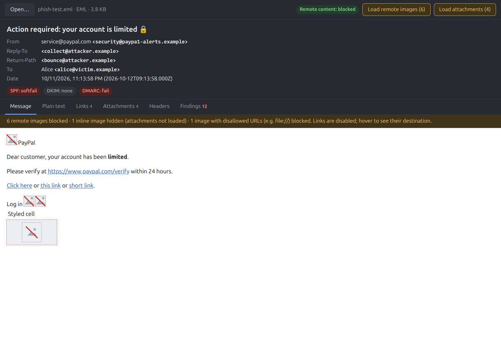
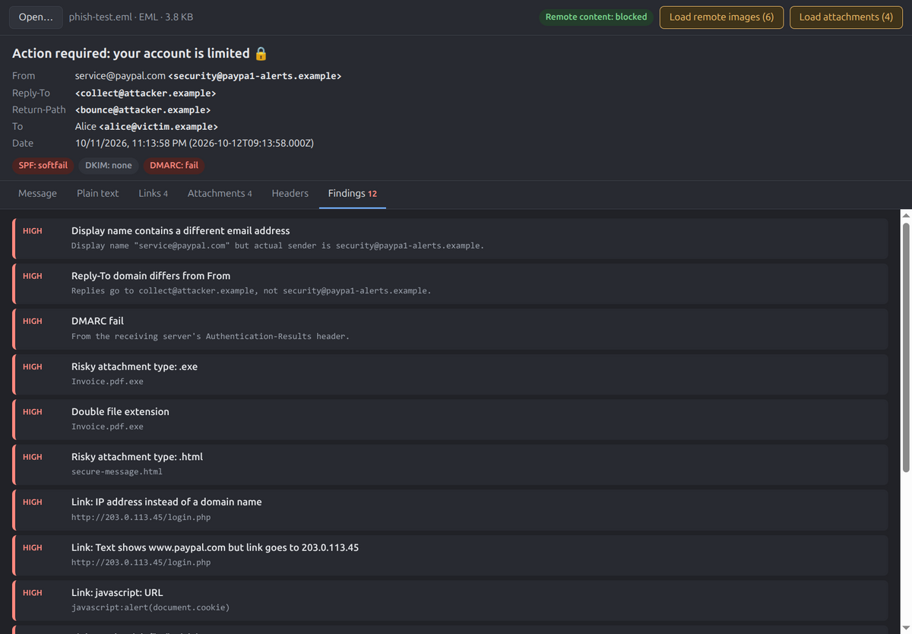
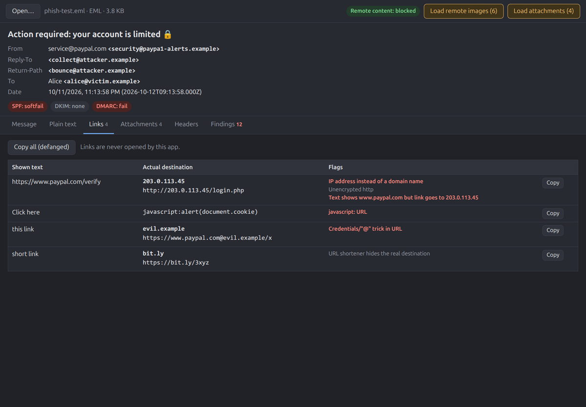
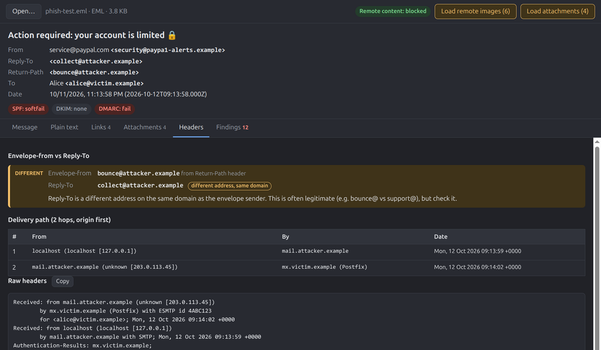
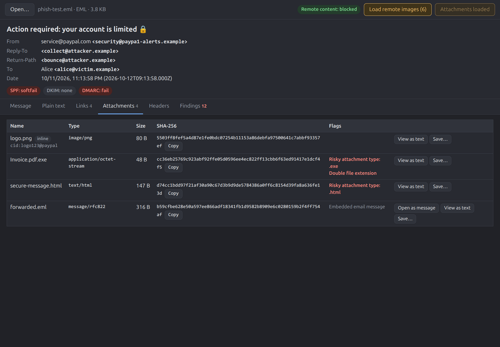

<p align="center">
  
</p>

<h1 align="center">MailView</h1>

<p align="center">
  <strong>A safe desktop previewer for suspected phishing emails.</strong><br>
  Open <code>.eml</code>, <code>.emlx</code>, <code>.msg</code> and <code>.mht</code> files without tipping off the sender or exposing attachments.
</p>

<p align="center">
  <a href="LICENSE"></a>
  
  
  
</p>

<p align="center">
  
</p>

---

## Why MailView?

When someone reports a suspicious message, opening it in a normal mail client can:

- **Fire tracking pixels.** These confirm to the sender that the message was opened and reveal your IP address.
- **Leak credentials.** For example, `file://` / UNC image paths can trigger SMB NTLM hash leaks on Windows.
- **Run active content** or let a single misclick follow a credential-harvesting link.

MailView shows the message with **everything risky blocked by default**. You choose exactly what to load, and it gives you the headers, links and indicators you need for triage.

## Features

- 🛡️ **Blocked by default.** Remote images, inline images and attachments don't load until you click a button. Scripts, forms, iframes, embeds, SVG, `<meta refresh>` and `<base>` are always stripped.
- 🔗 **Links are never clickable.** Hover a link to see its real destination. The Links tab lists every link and flags mismatched text, IP-address hosts, punycode, `user@host` tricks, `javascript:` URLs and shorteners. **Copy all (defanged)** gives you links like `hxxps[://]example[.]com` for safe sharing.
- 📎 **Safe attachment handling.** Shows the SHA-256 hash and flags for each file: risky or double extensions, RTL-override names and archives. You can view a file as text or save it, but it is never opened. Attached `.eml` / `.msg` files can be **opened as messages** in a new window, which is ideal for reported-phish forwards.
- 📨 **Header analysis.** A sender summary keeps the display name separate from the address. It also shows SPF/DKIM/DMARC results, the delivery path (Received hops, origin first) and the raw headers.
- ↩️ **Envelope-from vs Reply-To.** Highlights when replies would go somewhere other than the envelope sender, which is a hallmark of BEC and reply-chain fraud.
- 🚩 **Findings tab.** Heuristic indicators in one ranked list: display-name spoofing, Reply-To / Return-Path / Sender mismatches, authentication failures, risky attachments and suspicious links.
- 🔒 **Hardened Electron.** Sandboxed renderer, context isolation, an in-memory session and a main-process network filter. Packaged builds also set Electron fuses.

## Screenshots

| Findings | Links |
|---|---|
|  |  |
| **Headers** | **Attachments** |
|  |  |

## Supported formats

| Extension | Source | Notes |
|---|---|---|
| `.eml` | Standard RFC 5322 / MIME | Thunderbird, Apple Mail, Gmail exports, most clients |
| `.emlx` | Apple Mail | Byte-count prefix and plist trailer are handled |
| `.msg` | Microsoft Outlook | HTML, RTF-encapsulated HTML and plain bodies. Embedded `.msg` attachments are supported |
| `.mht` / `.mhtml` | MIME HTML archives | |

## Getting started

### Download

Builds are on the [Releases page](https://github.com/justinsloan/mailview/releases/latest):

- **Windows:** `MailView-Setup-<version>-x64.exe` (or `-arm64.exe` for ARM PCs). See [Installing on Windows](#installing-on-windows).
- **macOS:** `MailView-<version>-mac-arm64.dmg` for Apple silicon (M1 and later), or `-mac-x64.dmg` for Intel Macs. See [Installing on macOS](#installing-on-macos).
- **Linux:** `.deb` and `.rpm` packages. See [Installing the Linux packages](#installing-the-linux-packages).

### Run from source

Requires [Node.js](https://nodejs.org/) 22.12 or newer.

```sh
git clone https://github.com/justinsloan/mailview.git
cd mailview
npm install
npm start
```

Open a message with **File → Open** (<kbd>Ctrl</kbd>+<kbd>O</kbd>), by dragging a file onto the window, or from the command line:

```sh
npx electron . path/to/suspicious.eml
```

### Usage

| Action | What it does |
|---|---|
| **Load remote images** | Asks for confirmation, then allows **image requests only** for this message. |
| **Load attachments** | Shows attachment details and hashes, and displays inline `cid:` images. Never runs a file. |
| **View → Reset view** | Re-renders the current message with everything blocked again. |
| **Help → About** | Version, copyright and license. |

> [!WARNING]
> Loading remote images tells the sender the message was opened and reveals your IP address. Consider doing it only from an isolated analysis network.

## How it stays safe

Each of these layers blocks remote content on its own:

```text
 message file
     │
     ▼
 ① Main-process parsing ─── mailparser / msgreader run in Node, never in the page.
     │                       cid: images are not inlined automatically.
     ▼
 ② DOMPurify sanitizer ──── Parses in an inert document. Strips active content,
     │                       removes every href, swaps image sources for placeholders.
     ▼
 ③ Per-message CSP ──────── script-src 'none'; img-src data: (http/https only after opt-in)
     │
     ▼
 ④ Sandboxed iframe ─────── sandbox="": no scripts, forms, popups, navigation or same-origin
     │
     ▼
 ⑤ Network filter ───────── webRequest cancels every http(s) request unless that window
                             opted in, and then allows images only. file:// is limited to the
                             app's own files. Referer/Cookie/Set-Cookie headers are stripped.
```

Plus Electron hardening: `sandbox`, `contextIsolation`, no Node integration, all permissions denied, navigation / `window.open` / downloads / `<webview>` blocked, an in-memory session (no disk cache), and a startup check that refuses to run if Chromium's OS sandbox has been disabled.

MailView never sends your Windows or Kerberos (NTLM/Negotiate) credentials automatically, even to intranet hosts. Saved attachments are marked as downloaded from the internet: on Windows they get the *Mark of the Web*, so SmartScreen and Office Protected View apply, and on macOS they're quarantined, so Gatekeeper checks them before they open.

## Building

```sh
npm run dist       # all Linux packages (below)
npm run pack       # → dist/linux-unpacked/ (quick check, no packages)
npm run dist:win   # Windows installers and zips (below)
npm run pack:win   # → dist/win-unpacked/ (quick check, no installer)
npm run dist:mac   # macOS disk images and zips (below; run on a Mac)
npm run pack:mac   # → dist/mac-arm64/MailView.app (quick check)
```

| File | For |
|---|---|
| `dist/mailview_<version>_amd64.deb` | Debian, Ubuntu, Mint, Pop!_OS |
| `dist/mailview-<version>.x86_64.rpm` | Fedora, RHEL, openSUSE |
| `dist/MailView-<version>.AppImage` | Any distro, no install needed |
| `dist/mailview-<version>.tar.gz` | Any distro, manual install |

Building the `.rpm` requires `rpmbuild` on the build machine (`sudo apt install rpm` on Debian/Ubuntu). To build only some targets, list them: `npx electron-builder --linux AppImage deb tar.gz`.

Packaged builds have these [Electron fuses](https://www.electronjs.org/docs/latest/tutorial/fuses) set: `RunAsNode` off, `NODE_OPTIONS` and `--inspect` flags ignored, and `OnlyLoadAppFromAsar` on.

| File | For |
|---|---|
| `dist/MailView-Setup-<version>-x64.exe` | Windows 10/11 installer (Intel/AMD) |
| `dist/MailView-Setup-<version>-arm64.exe` | Windows 11 installer (ARM) |
| `dist/MailView-<version>-win-x64.zip` | Windows, no install needed (Intel/AMD) |
| `dist/MailView-<version>-win-arm64.zip` | Windows, no install needed (ARM) |
| `dist/MailView-<version>-mac-arm64.dmg` | macOS, Apple silicon |
| `dist/MailView-<version>-mac-x64.dmg` | macOS, Intel |
| `dist/MailView-<version>-mac-arm64.zip` / `-mac-x64.zip` | macOS, the app without a disk image |

Windows builds are best made on Windows. They can be cross-built on Linux, but the installer step needs Wine (`sudo apt install wine64 wine32:i386` on Debian/Ubuntu). macOS builds must be made on a Mac: only macOS can create the `.dmg` and sign the app, and Apple silicon Macs won't run an unsigned one. Without a Developer ID certificate, `npm run dist:mac` skips signing; use `npx electron-builder --mac -c.mac.identity=-` for an ad-hoc signed build.

The [build workflow](.github/workflows/build.yml) builds both on GitHub's Windows and macOS runners. It runs the smoke test and launches the packaged app on each, and attaches the builds to the release when a `v*` tag is pushed. Builds are unsigned (Windows) or ad-hoc signed (macOS) unless you set repository secrets:

| Secrets | Effect |
|---|---|
| `WIN_CSC_LINK`, `WIN_CSC_KEY_PASSWORD` | Sign the Windows builds (certificate as base64 or a URL) |
| `MAC_CSC_LINK`, `MAC_CSC_KEY_PASSWORD` | Sign the macOS builds with a Developer ID Application certificate |
| `APPLE_ID`, `APPLE_APP_SPECIFIC_PASSWORD`, `APPLE_TEAM_ID` | Also notarize the macOS builds, so Gatekeeper opens them without a warning |

Packaged Windows and macOS builds also have the `EnableEmbeddedAsarIntegrityValidation` fuse set, so MailView refuses to start if its `app.asar` has been modified. macOS builds use the hardened runtime.

### Installing on Windows

Run `MailView-Setup-<version>-x64.exe`. It installs for your account only by default (no admin rights needed); choose **Anyone who uses this computer** to install for all users. It adds Start menu and desktop shortcuts and registers MailView under **Open with** for `.eml`, `.emlx`, `.msg`, `.mht` and `.mhtml` files. It doesn't change your default app for any of them: to make MailView the default, right-click a file, choose **Open with → Choose another app**, pick MailView and select **Always**. Uninstall from **Settings → Apps**; your other apps' file associations are left as they were.

The zip needs no install: extract it and run `MailView.exe`.

> [!NOTE]
> Release builds aren't code-signed yet, so Windows SmartScreen may show **Windows protected your PC**. Check the SHA-256 against `SHA256SUMS-windows.txt` on the release, then choose **More info → Run anyway**.

### Installing on macOS

Open the `.dmg` and drag MailView to Applications. MailView appears under **Open With** for `.eml`, `.emlx`, `.msg`, `.mht` and `.mhtml` files, but it doesn't take over your default app (usually Mail or Outlook). To make it the default, select a file, choose **File → Get Info**, pick MailView under **Open with** and click **Change All…**.

> [!NOTE]
> Release builds aren't signed with an Apple Developer ID or notarized yet, so the first time you open MailView, macOS says it can't verify the app. Check the SHA-256 against `SHA256SUMS-mac.txt` on the release, then go to **System Settings → Privacy & Security**, scroll down and click **Open Anyway** next to the message about MailView.

### Installing the Linux packages

```sh
sudo apt install ./mailview_1.0.0_amd64.deb      # Debian / Ubuntu
sudo dnf install ./mailview-1.0.0.x86_64.rpm     # Fedora / RHEL
```

The packages install to `/opt/MailView`, add a `mailview` command and an app-menu entry, and on Ubuntu 24.04+ install an AppArmor profile so Chromium's sandbox works. They also register MailView under **Open With** for `.eml`, `.emlx`, `.msg`, `.mht` and `.mhtml` files. Installing MailView doesn't change an existing default app. If no other app handles one of these types, your desktop may open it with MailView. Remove it with `sudo apt remove mailview` or `sudo dnf remove mailview`.

For the AppImage: `chmod +x MailView-1.0.0.AppImage && ./MailView-1.0.0.AppImage`. It needs FUSE 2 (`libfuse2t64` on Ubuntu 24.04+).

> [!IMPORTANT]
> MailView refuses to start if Chromium's sandbox is disabled (`--no-sandbox` or similar flags), because the sandbox is what contains a malicious message that exploits a browser bug. On distros that block unprivileged user namespaces, including **Ubuntu 24.04 and later**, the AppImage launcher turns the sandbox off, so MailView won't run from the AppImage there. Use the `.deb` or `.rpm` instead; they install the AppArmor profile the sandbox needs.

## Development

```text
src/
├── main.js            Main process: windows, IPC, network filter, menus
├── preload.js         Minimal contextBridge API
├── parser.js          .eml / .emlx / .msg / .mht → normalized message
├── analysis.js        Header and attachment heuristics, envelope-from vs Reply-To
├── quarantine.js      Marks saved attachments as downloaded (Windows, macOS)
└── renderer/
    ├── index.html     UI shell and CSP
    ├── sanitize.js    DOMPurify config, link/image rewriting, iframe CSP
    ├── renderer.js    UI logic and link heuristics
    └── styles.css     Light/dark theme
samples/               Synthetic phishing messages for testing
scripts/               Parser check, download-mark check and Electron smoke test
```

```sh
# Parse a message and print the summary + findings (no Electron)
node scripts/parse-check.js samples/phish-test.eml

# End-to-end smoke test: logs every allowed/blocked request and saves screenshots
MAILVIEW_LOG_REQUESTS=1 npx electron scripts/smoke-test.js samples/phish-test.eml /tmp/shots
```

`MAILVIEW_LOG_REQUESTS=1` also works with `npm start` and logs every request the network filter allows or blocks.

## Known limitations

- Remote **images** are the only remote content you can opt in to. Remote fonts and stylesheets stay blocked.
- In MHT files, resources referenced by `Content-Location` (rather than `cid:`) are not resolved.
- TNEF (`winmail.dat`) attachments are listed, but their contents are not unpacked.
- Findings are heuristics. Domain comparison uses a simplified registrable-domain rule. **A clean result does not mean a message is safe.**

## License

Copyright © 2026 Justin Sloan. Released under the [MIT License](LICENSE).

MailView bundles third-party open-source components (Electron, DOMPurify, mailparser, msgreader and their dependencies) under their own permissive licenses: MIT, BSD, Apache-2.0 and MPL-2.0.
